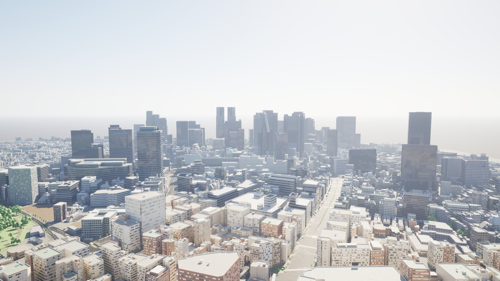
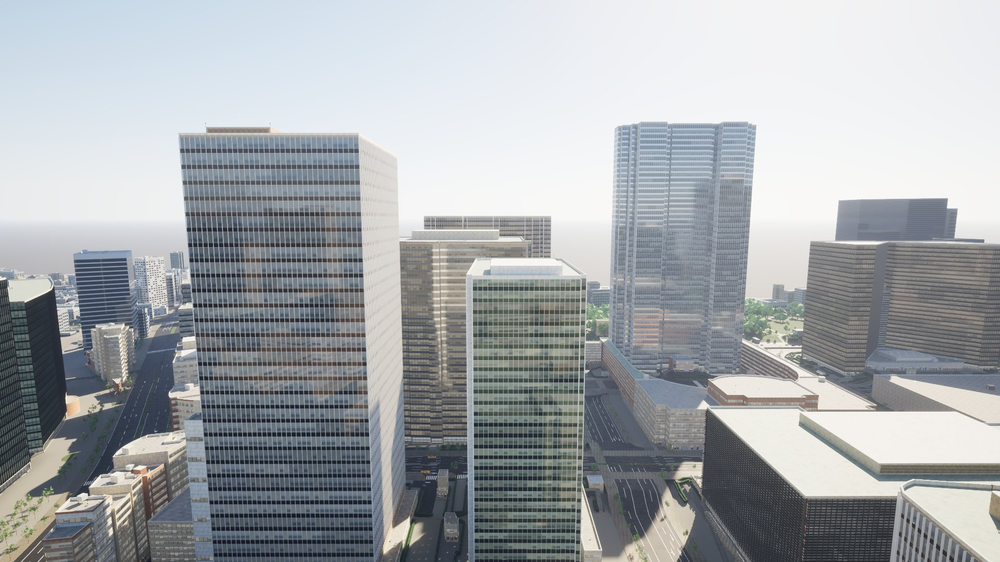
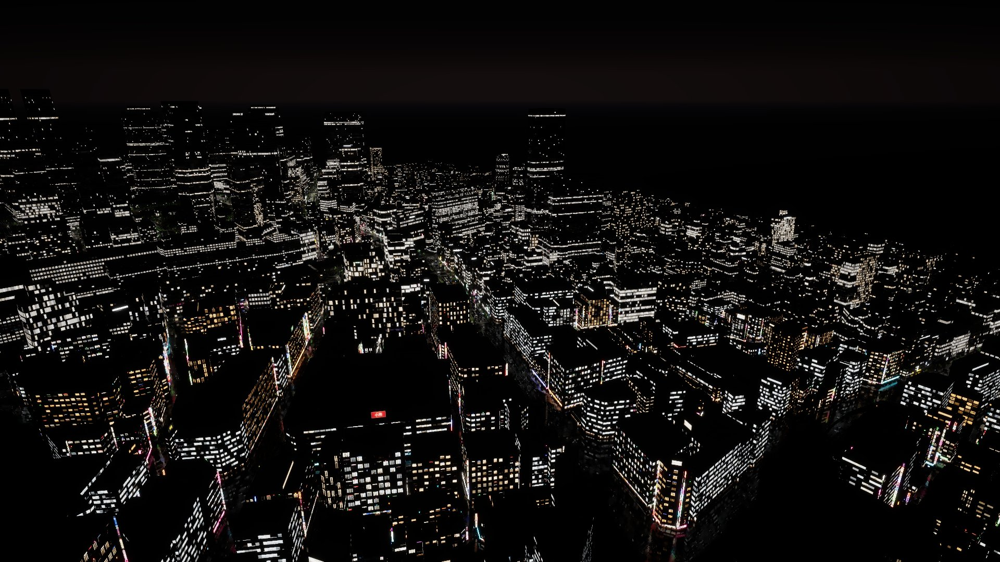

<h1 align="center">TokyoRT</h1>

<p align="center"><b>All of Shinjuku and Shibuya, streamed by level of detail around a camera you fly, path-traced in real time with <a href="https://github.com/meshy-dev/ThreeRT">ThreeRT</a>. No baked lighting.</b></p>

<p align="center">
  
</p>

Every building stands where it stands in Shinjuku and Shibuya (two compiled areas side by side, about 19 km²): footprints, heights and uses come from Japan's open 3D city model
([Project PLATEAU](https://www.mlit.go.jp/plateau/)), streets and power lines from OpenStreetMap, the ground from GSI.
On top of that, rules written in TypeScript dress each building in a late-Shōwa look: tile-clad mixed-use blocks,
aluminium sashes, balconies and penthouses, shopfronts and fascias, sign towers, neon, and at street level the bars of
Golden Gai with their lightboxes, noren, lanterns, gas meters, crates and bicycles. 240 made-up shops each keep one
name across all their signs. No photographs or scans: every material, model and tree is generated by code in this
repository. Nothing is lit in advance: every light, shadow, reflection and bounce is traced as you fly.

<p align="center">
  
</p>

<p align="center">
  
</p>

<sub>Frames of the offline path tracer (128–192 samples a pixel, denoised). The live view renders the same scene at
0.5–0.6 resolution scale with temporal accumulation and MetalFX's denoiser: noisier in motion, the same light.</sub>

## Run it

macOS on Apple silicon (M3 or later: hardware ray tracing), [Rust](https://rustup.rs), [Node](https://nodejs.org) 24,
about 40 GB of disk and the system's Japanese fonts (Hiragino, drawn into the signs). Building everything takes
a quarter of an hour on an M3 Max, plus the engine's build and the downloads (~2.8 GB from PLATEAU, OpenStreetMap and
GSI).

```bash
git clone --recursive https://github.com/threert/TokyoRT && cd TokyoRT
tools/setup.sh          # engine, downloads, the compiled areas, their far levels, every dressed cell
tools/demo.sh           # day; or tools/demo.sh night / dusk, and a start point: tools/demo.sh night 360,-496
```

Click to capture the pointer (**Esc** lets go). **Mouse** to look, **W A S D** to move, **Space** / **E** up,
**C** / **Q** down, **Shift** faster, the **wheel** scales the speed; **1** / **2** / **3** for day / dusk / night,
**T** to cycle them; **M** switches the denoiser between the device's (MetalFX's on a Mac, DLSS Ray Reconstruction
on an RTX GPU) and ThreeRT's own. You start in a Golden Gai alley; fly up and out over the city. The first frame takes
10–20 s.

Room options, appended to the room id (`tools/demo.sh` takes the room's time; the tools take whole rooms):
`-builtin` starts with ThreeRT's denoiser; `-lowmem` fits a GPU of 8 GB (an RTX laptop's: the mid level to 320 m,
the far level without its props and trees; with `THREERT_TEX_MAX_DIM=1024`); `-r0=m`, `-r1=m` set the street and
mid levels' radii (140 and 480 m).

`node tools/tour.ts tokyo-night-tour 90` flies a set path in the live view and prints its frame times;
`node tools/tour.ts tokyo-day-route=drive` (or `=expressway`, `=flight`) runs one of the benchmark routes to its end:
Meiji-dōri from Shinjuku over the areas' seam to Shibuya at 60 km/h (4.6 km), Shuto Route 3 across Shibuya on its
elevated deck at 100 km/h (3.1 km), the line of Meiji-dōri at roof height at 150 km/h (4.6 km)
(`tools/tokyo/routes.ts`, from the compiled road graph);
`node tools/shot.ts` renders a still with the offline path tracer (as above).

## How it works

The city is three levels of detail, picked per 128 m cell by distance from the camera:

| level | where | what it is |
|---|---|---|
| far | always resident | PLATEAU's buildings as compiled (surveyed LOD2 shells where PLATEAU has them, walls and roofs from footprint and height elsewhere, window grids) in the colours the near levels dress each one in (its wall finish's mean, a tower's spandrels and curtain glass; by day its windows show their rooms), trees, the ground of every tile with its roads in generated asphalt and pavers |
| mid (L1) | within ~480 m | each cell's buildings rebuilt from their footprints: windows by building, materials, bands and balconies, signs and sign towers, roofs with their tanks and air conditioners, trees; towers (45 m and up) in curtain walls with lobbies, plant rooms, aviation lights and over 100 m the emergency helipad |
| street (L0) | within ~140 m | the same buildings in full: doors and windows cut into the walls with depth, shops and bars, eaves, lanterns, noren, meters, pipes, utility poles and wires across the alleys, gutters, props |

- **Baking the cells** (`tools/tokyo/city-bake.ts`): the dressing rules (`scene/hero/dress.ts`) run once per cell and
  level and write what they make: meshes per material, and where the kit's pieces stand.
- **The kit** (`kit.bin`): what repeats, once. Windows (drawn at the nearest of a few standard sizes 12 % apart and
  stretched to their own by their instance: two pieces each, what sits in the opening and what is on the wall),
  gutter gratings, the street models and the props: 8,350 pieces, 0.7 M triangles. A cell has its copies of a piece as
  frames; a piece it has fewer than 8 copies of, of few triangles, goes into its meshes instead. Shinjuku is 598 cells:
  166 M triangles of their own at street level and 63 M at mid distance, 1.7 M and 0.45 M copies of the kit's pieces;
  15 GB (each window drawn out was 23 GB).
- **Streaming** (`scene/city.game.ts`): the scene reads a cell's meshes and kit frames as the camera nears it
  (`readAsset`, a range of the file at a time) and adds them in place, a frame budget at a time: its meshes, its kit
  pieces (one instanced mesh a piece and material, every copy sharing the piece's geometry), then what emits, together.
  The level it replaces goes afterwards, a few hundred objects a frame, and the far quadrant under it moves out of
  sight. The engine adds and removes them without rebuilding the scene, and builds its top-level acceleration structure
  from the instances that changed (half a million instances resident, a commit of ~5 ms): what that takes is in
  ThreeRT's [docs/RUNTIME.md, "Streaming"](https://github.com/meshy-dev/ThreeRT/blob/main/docs/RUNTIME.md).
- **The look** is rules, not hand placement: a style per building from its recorded use (shops, offices, flats, houses),
  one window module per building, signs and noren drawn per shop (`tools/tokyo/hero-shops.ts`), props built in code
  (`scene/hero/props.ts`: bicycles, scooters, vending machines, A-boards).
- **Generated assets**, built by `tools/setup.sh`: 26 tiling finishes at their real size, colour, normal and roughness
  from the same joints and relief (`tools/tokyo/surfaces.ts`: asphalt, pavers, stucco, tiles, brick, planks, shutters,
  corrugated sheet); the street clutter as small models (`scene/hero/street.ts`: air conditioners, crates,
  planters, propane bottles, power boxes, stools, manholes); street and park trees, ginkgo and cherry grown with
  [EZ-Tree](https://github.com/dgreenheck/ez-tree) at two levels of detail, and their far crowns (`tools/tokyo/trees.ts`).

## What is precomputed, and what is not

**No lighting is baked.** There are no lightmaps, light probes, irradiance volumes, baked ambient occlusion or
precomputed shadows. Every frame the path tracer traces the sun or the night sky, every lit sign, lantern, window and
lamp, their shadows, reflections in the wet streets and glass, and the light bouncing between buildings. The radiance
cache the live view keeps is built from those paths as it runs and follows the scene as it changes. Day, dusk and night
are the same scene under another sky, switched live.

What is computed ahead is **geometry and textures**: the compiled city tiles, the far level's meshes, the dressed
cells, the generated finishes, street models and trees, and the textures drawn for signs, lanterns, noren, menus and
labels.

Two things worth saying alongside:
- **No photographs.** No texture is a photograph or a scan, so none carries the light and shadows of the day it was
  taken: what shades a wall is the traced sun or sky, never a picture of one.
- **Far lights are seen, not sampled.** Lit windows and signs of the far level, and by night those of the mid level,
  are drawn unlit: they show their light and do not light their surroundings (light sampling is kept for the lights
  near the camera). Rooms behind frosted glass are emissive pictures of interiors, not modelled rooms.
- **Rooms behind windows are pictures.** By night a lit room's picture is a light. By day every room shows its
  curtains, blinds or shelves at a daylit interior's brightness and takes no light itself: what it would take, the
  sky's light through the pane, a path finds only by chance, and the windows came out black and sparkling.

## Performance

Measured on an M3 Max, flying the tour (`tools/tour.ts`, 90 s, streaming all the way; leaving out the first 20 s,
while the resolution scale settles), at 0.5–0.6 resolution scale, with no scene rebuild:

| frame interval | by day | by night |
|---|---|---|
| MetalFX's denoiser (default) | p50 17 ms, p95 32 ms, p99 41 ms | p50 17 ms, p95 48 ms, p99 61 ms |

(ThreeRT's own denoiser, `-builtin` or **M**, costs about the same.) MetalFX holds sunlit walls and windows steadier.
Flying slowly or standing it holds 60 fps. The script engine no longer pauses to collect garbage (a scene object is 8
script objects, none in a cycle: ThreeRT #205); what is left of the slow frames in fast flight is the streaming's
commits (a cell's meshes and their acceleration structures), the next thing to make cheaper. By day the
street level's unlit signs and windows are not lights at all; switching between day and night loads the near cells
again, the nearest first, in a second or two.

The benchmark routes by day (`tools/tour.ts tokyo-day-route=…`, after the first 20 s), with both areas resident:

| route | frame interval | physical footprint at the end |
|---|---|---|
| drive, Meiji-dōri, 60 km/h, 274 s | p50 29 ms, p95 47 ms, p99 55 ms | 43 GB |
| expressway, Shuto Route 3, 100 km/h, 113 s | p50 32 ms, p95 40 ms, p99 46 ms | 39 GB |
| flight at roof height, 150 km/h, 110 s | p50 30 ms, p95 39 ms, p99 48 ms | 41 GB |

Shibuya resident costs the tour (which stays in Shinjuku) ~1.5 ms at p95 and p99, and 8 GB (33 GB at the end against
25 GB with Shinjuku alone); the first frame takes 22 s (13 s). The footprint grows along a route: the memory of the
levels left behind is not given back yet. Both are ROADMAP § 0 step 2's to bring down (≤ 1.5 ×
one area's memory, first frame ≤ 3 s, p95 ≤ 16.7 ms).

## Limits

- Two areas: Shinjuku and Shibuya (each about 3.4 × 2.8 km, Shibuya's north edge Shinjuku's south edge). Each is
  compiled and baked in its own frame and placed by its origin's offset (`tools/tokyo/stitch.ts`); their terrain stops
  at the seam. Shiba compiles with the same pipeline but is not stitched in.
- The far level of both areas is always resident: 34 M triangles, near the renderer's 4 GiB vertex buffer.
- No traffic or people yet.
- For a few frames while a cell changes level both levels show (a flicker at ~140 m); the far level beyond ~480 m is
  PLATEAU's blocks as compiled.
- Shop names, shop layout and interiors are made up; the buildings, streets and terrain are real.

## Layout

```
scene/            the scene: city.game.ts (levels, streaming, the fly camera), sky.ts, hero/ (the dressing rules,
                  materials, props, street models, shops)
tools/city/       the city compiler (PLATEAU / OSM / GSI -> 256 m tiles), from jeantimex/tokyo
tools/tokyo/      the far level (to-glb.ts --city), the cell baker and its kit, the drawn textures, the generated
                  finishes and trees (surfaces.ts, trees.ts), the data prefetchers
tools/            setup.sh, demo.sh, tour.ts, shot.ts, bundle.ts
engine/           ThreeRT (submodule): the renderer and the scene API
```

## Licences and credits

The code here is MIT (`LICENSE`). `tools/city` is from [jeantimex/tokyo](https://github.com/jeantimex/tokyo) (MIT, its
`LICENSE` kept).

The data is downloaded and built on your machine, not distributed here: buildings and roads, Project PLATEAU (MLIT
Japan, CC BY 4.0); elevation, Geospatial Information Authority of Japan (GSI); roads, rails and places
© OpenStreetMap contributors (ODbL; the compiled tiles and baked cells are a derived database under it). The trees are
grown with [EZ-Tree](https://github.com/dgreenheck/ez-tree) by Daniel Greenheck (MIT), a build-time dependency.
